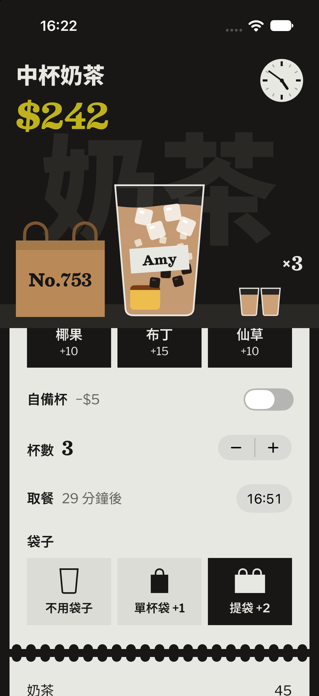

# 手搖飲點餐

一頁完成的 SwiftUI 手搖飲點餐 App。從上往下填完名字、飲料、杯型、甜度、冰塊、加料、杯數和取餐時間，畫面上的那杯飲料會跟著每個選擇即時變化，最後按送出跳出 alert 顯示訂單明細和總價。



作業文章：[docs/article.md](docs/article.md)

## 執行

需要 Xcode 16 以上，最低支援 iOS 18。直接打開 `DrinkOrder.xcodeproj` 執行即可。

專案檔是用 [XcodeGen](https://github.com/yonaskolb/XcodeGen) 從 `project.yml` 產生的，新增檔案後重新產生：

```bash
xcodegen generate
```

## 字型

`DrinkOrder/Fonts/` 裡的 Besley、Libre Franklin、思源黑體（Noto Sans TC）都來自 Google Fonts，採用 SIL Open Font License，授權檔放在同一個資料夾。
