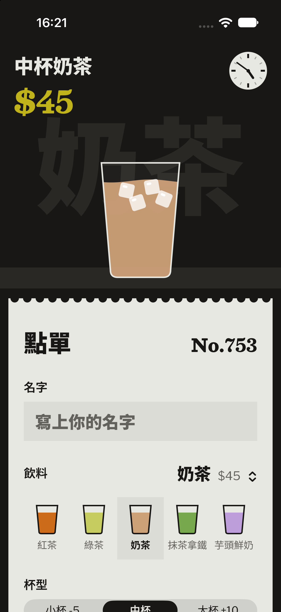
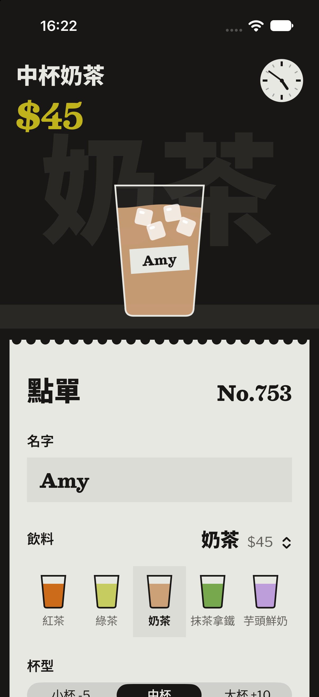
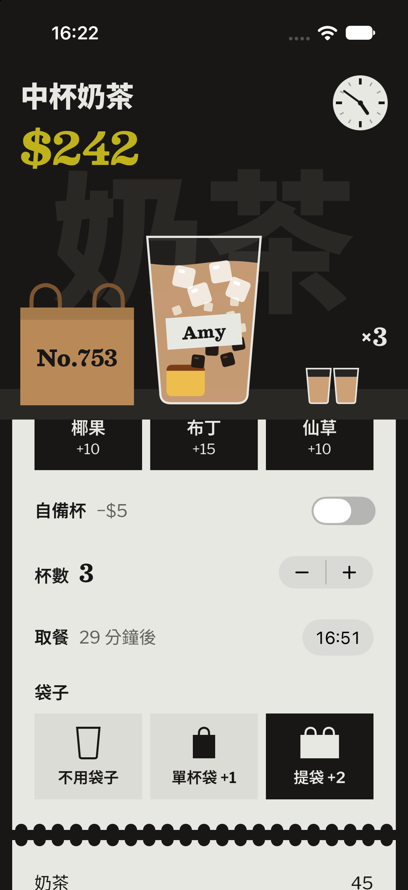
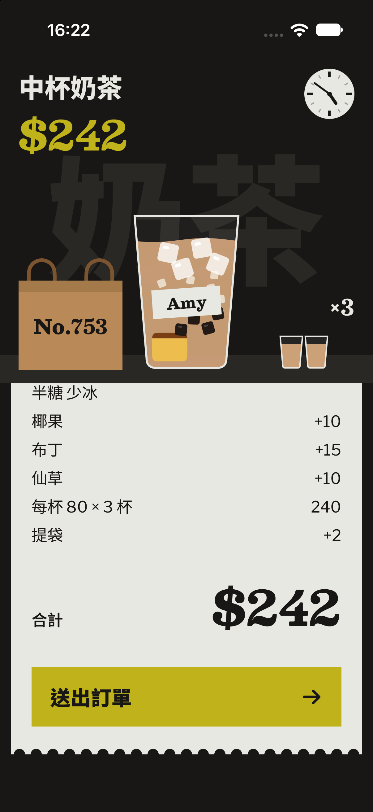
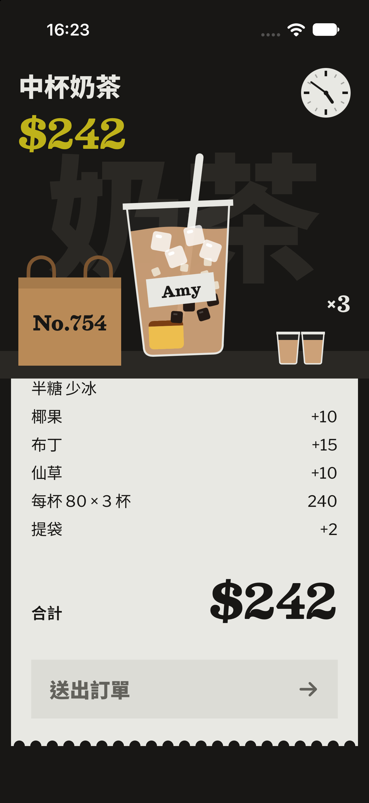
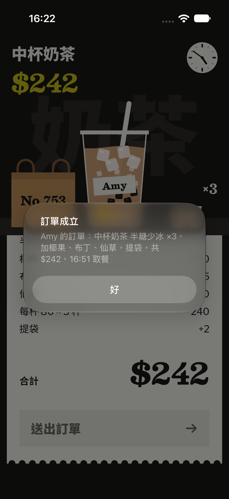

# #0X 結合各種輸入元件｜手搖飲點餐

GitHub 連結：https://github.com/cpcap1214/drink-order

## 一、創作發想

這次的作業是把各種輸入元件放在同一個 App 裡，最後按按鈕跳出 alert。我第一個想到的就是手搖飲點餐。

點一杯手搖飲本來就要做一連串的選擇：名字、飲料、大中小杯、甜度、冰塊、要不要加珍珠、幾杯、幾點來拿。剛好每一個選項都可以對應到一種輸入元件，所以拿來做這次的作業剛剛好。

不過如果只是一排表單，填起來會有點無聊。所以我在畫面上放了一杯飲料，每改一個選項，杯子就會跟著變：打名字時杯子上的貼紙會一個字一個字浮出來，加珍珠時珍珠會從杯底彈上來，按送出時杯子會封膜、插吸管、搖一搖。

介面的部分，我想做成手搖飲店出單機印出來的那張點單標籤：墨黑色的底、紙灰色的單子，上下兩邊有一排半圓形的缺口，像剛從機器撕下來一樣。

## 二、App 畫面與操作

下面由左到右是一開始的畫面、打好名字之後、加了料和袋子之後。





畫面分成上下兩塊：上面是一杯飲料，下面是可以往下捲的點單。

操作方式：

1. 名字：打字之後，杯子上的貼紙會一個字一個字出現。
2. 飲料：可以從選單選，也可以直接點下面五個小杯子。換飲料的時候，杯子裡的顏色會慢慢變過去。
3. 杯型：選大中小杯，杯子會用彈簧動畫縮放。
4. 甜度：往右拉的時候，杯子上方會有糖粒掉下來，甜度越高掉越多。
5. 冰塊：冰塊會從上面掉進杯子，濺起一點水花；拉到去冰的話，冰塊會融化消失。
6. 珍珠：打開時珍珠一顆一顆從杯底彈上來，關掉就往下沉不見。
7. 加料、自備杯、袋子：椰果、布丁、仙草會出現在杯子裡；自備杯會讓杯框變成黃銅色；選了袋子，旁邊會升起一個印著單號的紙袋。
8. 杯數：按加號，右下角會多一杯小杯子滑進來。
9. 取餐時間：右上角的時鐘指針會轉到選好的時間。
10. 送出：杯子蓋上封膜、插上吸管、搖一搖，接著跳出 alert 顯示訂單明細。

點單最下面是撕下來的存根，會像收據一樣把每一項列出來，最後是合計。



## 三、作業要求：各種輸入元件與 alert

訂單的資料都放在 `Models.swift` 的 `DrinkOrder` 裡，每個輸入元件都綁在它的其中一個屬性上，杯子再根據這些屬性畫出來。

### 1. TextField：名字貼紙

名字用 `TextField` 輸入，最多 10 個字：

```swift
TextField("", text: $order.name,
          prompt: Text("寫上你的名字").foregroundStyle(Theme.muted))
    .focused($nameFocused)
    .submitLabel(.done)
    .onChange(of: order.name) { _, new in
        if new.count > 10 { order.name = String(new.prefix(10)) }
    }
```

杯子上的貼紙則是把名字拆成一個一個字，每個字都有自己的 transition，所以多打一個字，就只有那個字會彈出來：

```swift
HStack(spacing: 0) {
    ForEach(Array(name.enumerated()), id: \.offset) { _, ch in
        Text(String(ch))
            .transition(
                .asymmetric(
                    insertion: .scale(scale: 0.1).combined(with: .opacity).combined(with: .offset(y: -8)),
                    removal: .opacity
                )
            )
    }
}
```

`id: \.offset` 是用字的位置當作 id，前面的字位置不變，就不會重新跑動畫。

### 2. Picker：飲料種類

飲料是一個 enum，每一種都有自己的價錢和顏色：

```swift
enum DrinkType: String, CaseIterable, Identifiable {
    case blackTea = "紅茶"
    case greenTea = "綠茶"
    case milkTea = "奶茶"
    case matchaLatte = "抹茶拿鐵"
    case taroMilk = "芋頭鮮奶"
    // price、color 依 case 回傳
}
```

`Picker` 包在 `Menu` 裡面，這樣按鈕上可以顯示比較大的飲料名稱和價錢：

```swift
Menu {
    Picker("飲料種類", selection: $order.drink) {
        ForEach(DrinkType.allCases) { d in
            Text("\(d.rawValue)  $\(d.price)").tag(d)
        }
    }
} label: { ... }
```

杯子裡的液體只要加上 `.animation(.easeInOut(duration: 0.8), value: order.drink)`，換飲料時顏色就會從琥珀色慢慢變成奶咖色，不用自己算中間的顏色。

### 3. SegmentedControl：杯型

杯型用 `.pickerStyle(.segmented)`。杯子本身是用大杯的尺寸畫的，再依照杯型縮放：

```swift
CupView(order: order, sealed: sealed, strawIn: strawIn)
    .scaleEffect(order.size.scale, anchor: .bottom)
    .animation(.spring(response: 0.45, dampingFraction: 0.45), value: order.size)
```

`anchor: .bottom` 讓杯子從底部縮放，看起來是站在吧台上變大變小，而不是浮在半空中。`dampingFraction` 設得比較小，縮放完會多彈幾下。

### 4. Slider：甜度和冰塊

甜度有五段、冰塊有四段，所以 `Slider` 都加上 `step: 1`。下面再把每一段的名稱印出來，目前選到的那一段用粗體，點文字也可以直接選。

糖粒是用 `onChange` 監聽甜度。往右拉的時候，會依照新的甜度產生一批糖粒，甜度越高數量越多：

```swift
private func dropSugar(from old: Int, to new: Int) {
    guard new > old, new > 0 else { return }
    let count = new * 7 + 3
    // 產生 count 顆糖粒，每顆有不同的位置和延遲
    grains += newGrains
    Task {
        try? await Task.sleep(for: .seconds(1.6))
        grains.removeAll { ids.contains($0.id) }
    }
}
```

每顆糖粒出現之後，從杯子上方掉到液面，再淡掉；1.6 秒後把這一批從陣列裡移掉。

冰塊則是用 transition 做出「掉進來」和「融化」兩種不一樣的動畫：

```swift
static func iceTransition(index: Int) -> AnyTransition {
    .asymmetric(
        insertion: .offset(y: -170)
            .combined(with: .opacity)
            .animation(.spring(response: 0.45, dampingFraction: 0.5).delay(Double(index % 2) * 0.12)),
        removal: .modifier(active: MeltModifier(progress: 1), identity: MeltModifier(progress: 0))
            .animation(.easeIn(duration: 1.1))
    )
}
```

出現的時候從上面 170 點的地方掉下來；消失的時候用自己寫的 `MeltModifier`，讓冰塊往下塌、變模糊、變透明，看起來就像融化了。冰塊變多的時候，還會在 0.3 秒後於液面放一個水花。

### 5. Toggle：加珍珠

珍珠一共 22 顆，排成一個小山。每一顆都依照自己的順序設定延遲：

```swift
.offset(y: isOn ? 0 : 80)
.opacity(isOn ? 1 : 0)
.animation(
    isOn
        ? .spring(response: 0.45, dampingFraction: 0.42).delay(Double(index) * 0.045)
        : .easeIn(duration: 0.6).delay(Double(total - index) * 0.02),
    value: isOn
)
```

打開的時候用彈簧，最下面一排先出來，一顆一顆疊上去；關掉的時候用 easeIn 往下沉，而且反過來從最上面那顆開始。因為整個杯子有 `clipShape`，珍珠沉到杯底以下就看不到了。

### 6. Stepper：杯數

`Stepper` 的範圍是 1 到 10。主杯之外，每多一杯，右下角就多一個小杯子，從右邊滑進來：

```swift
ForEach(0..<extra, id: \.self) { i in
    MiniCupView(color: color, sealed: sealed)
        .offset(x: CGFloat(i % 3) * 27, y: -CGFloat(i / 3) * 40)
        .transition(.offset(x: 180).combined(with: .opacity))
}
```

小杯子三個一排往上疊，最多可以放九杯。

### 7. DatePicker：取餐時間

`DatePicker` 只顯示時和分。右上角的時鐘會算出時針和分針的角度：

```swift
static func angles(for date: Date) -> (hour: Double, minute: Double) {
    let c = Calendar.current.dateComponents([.hour, .minute], from: date)
    let h = Double((c.hour ?? 0) % 12)
    let m = Double(c.minute ?? 0)
    return ((h + m / 60) * 30, m * 6)
}
```

這裡有一個小問題：如果從 59 分轉到 0 分，角度會從 354 度變成 0 度，指針會倒轉一整圈。所以我另外寫了 `shortest(from:to:)`，每次都往比較近的方向轉：

```swift
static func shortest(from current: Double, to target: Double) -> Double {
    var delta = (target - current).truncatingRemainder(dividingBy: 360)
    if delta > 180 { delta -= 360 }
    if delta < -180 { delta += 360 }
    return current + delta
}
```

旁邊還會顯示「30 分鐘後」，讓人不用自己算還要等多久。

### 8. Button + alert：送出

按下送出之後，動畫要一個接一個跑，所以用 `Task` 加上 `Task.sleep` 排順序：

```swift
private func submit() {
    nameFocused = false
    isSubmitting = true
    Task {
        withAnimation(.easeOut(duration: 0.4)) { sealed = true }      // 封膜
        try? await Task.sleep(for: .milliseconds(500))
        withAnimation(.spring(response: 0.45, dampingFraction: 0.55)) { strawIn = true }  // 插吸管
        try? await Task.sleep(for: .milliseconds(650))
        shakeCount += 1                                                // 搖一搖
        try? await Task.sleep(for: .milliseconds(1000))
        showAlert = true                                               // 跳出 alert
    }
}
```

搖一搖用的是 `keyframeAnimator`，每次 `shakeCount` 加一就跑一次：杯子以底部為中心左右轉 12 度、10 度、6 度，慢慢停下來，同時往上跳一下。



alert 的內容是 `DrinkOrder` 的 `summary`，有加料、自備杯、袋子的話才會加進去：

```swift
var summary: String {
    var parts = ["\(trimmedName) 的訂單：\(drinkTitle) \(sweetnessText)\(iceText) ×\(cups)"]
    if !toppings.isEmpty {
        parts.append("加" + sortedToppings.map(\.rawValue).joined(separator: "、"))
    }
    if ownCup { parts.append("自備杯") }
    if bag != .none { parts.append(bag.rawValue) }
    parts.append("共 $\(total)")
    parts.append("\(pickupText) 取餐")
    return parts.joined(separator: "，")
}
```



另外，名字沒填的時候，送出按鈕會變灰色，上面寫「先寫上名字」，這樣就不用再多一行提示文字。

### 9. 多加的選項：加料、自備杯、袋子

除了作業要求的元件，我又多加了幾個點飲料時常常會被問到的選項：

1. 加料：椰果 +10、布丁 +15、仙草 +10，可以複選，用 `Set<Topping>` 存。
2. 自備杯：每杯折 5 元。
3. 袋子：不用、單杯袋 +1、提袋 +2。

價錢的算法是：

```swift
var unitPrice: Int {
    drink.price + size.extraPrice
        + (pearls ? Self.pearlPrice : 0)
        + sortedToppings.reduce(0) { $0 + $1.price }
        - (ownCup ? Self.ownCupDiscount : 0)
}

var total: Int { unitPrice * cups + bag.price }
```

加料和自備杯是每一杯都要算，所以放在 `unitPrice` 裡；袋子是整筆訂單只收一次，所以在乘完杯數之後才加。

## 四、UI 設計

這次的介面沒有用任何圖片，杯子、冰塊、珍珠、袋子、時鐘全部都是用 SwiftUI 的 Shape 畫出來的。

### 1. 出單機的點單

整個表單做成一張點單標籤。上下兩邊的半圓缺口是自己寫的 `ScallopedSlip` Shape，沿著邊緣每隔一段距離用 `addArc` 咬掉一個半圓。

合計和送出按鈕放在另一張比較短的紙上，兩張紙中間露出一點黑色的底，看起來像是存根被撕下來。

杯子上的名字貼紙也是用同一種紙的顏色，所以打名字的時候，點單上和杯子上會同時出現一樣的字。

### 2. 配色

整個 App 只用了幾個顏色：

1. 墨黑：舞台的底色。
2. 紙灰：點單和貼紙。
3. 黃銅色：只用在上方的價錢、送出按鈕，還有自備杯的杯框。

其他的顏色都是飲料本身的顏色：紅茶的琥珀色、抹茶的綠色、芋頭的紫色。因為背景很素，飲料的顏色會特別明顯。

### 3. 字型

英文和數字用的是 Besley，一種很粗、字尾有小圓球的襯線字，有點像以前的海報字；內文用 Libre Franklin。中文則是思源黑體。

中文和英文要用不同字型，我是用 `UIFontDescriptor` 的 `cascadeList`：先用 Besley 排，遇到 Besley 沒有的中文字，就自動換成思源黑體。

### 4. 舞台

舞台上除了杯子，還有幾個小地方：

1. 背景放了一個很大的飲料名稱，顏色只比底色亮一點點，換飲料時會淡入淡出。
2. 杯子底下有一條吧台，杯子、小杯子和紙袋都站在上面。
3. 紙袋上面印著單號，跟點單最上面的「No.753」是同一個號碼，每送出一次就加一。

## 五、心得

做之前覺得把輸入元件排一排應該很快，實際做才發現，比較花時間的是「每個元件改了之後，畫面要怎麼反應」。

像冰塊，出現和消失其實是兩種完全不同的動作：一個是掉下來，一個是融化。如果只用一個 transition，看起來就會很假。還有時鐘從 59 分轉到 0 分會倒轉一圈、珍珠要從下面一顆一顆疊上去，這些都是做了才發現的細節。

這次也比較深刻地感受到，SwiftUI 的動畫大部分不用自己算，只要把狀態改掉，再告訴它要用什麼方式變過去就好。
